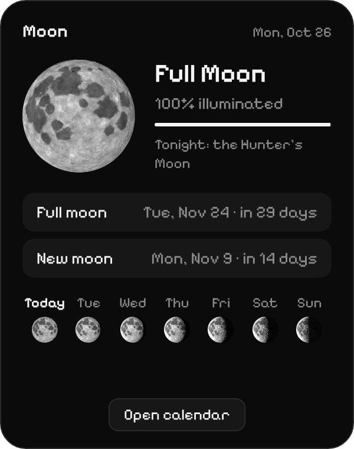
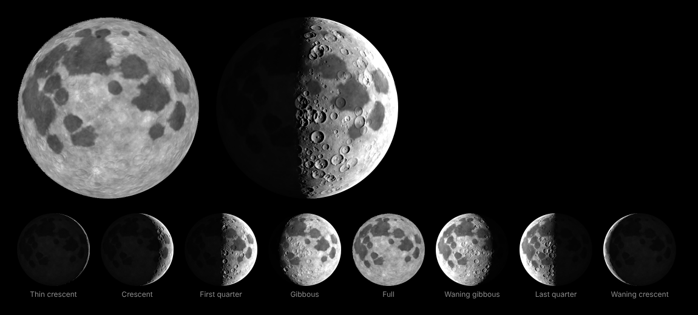
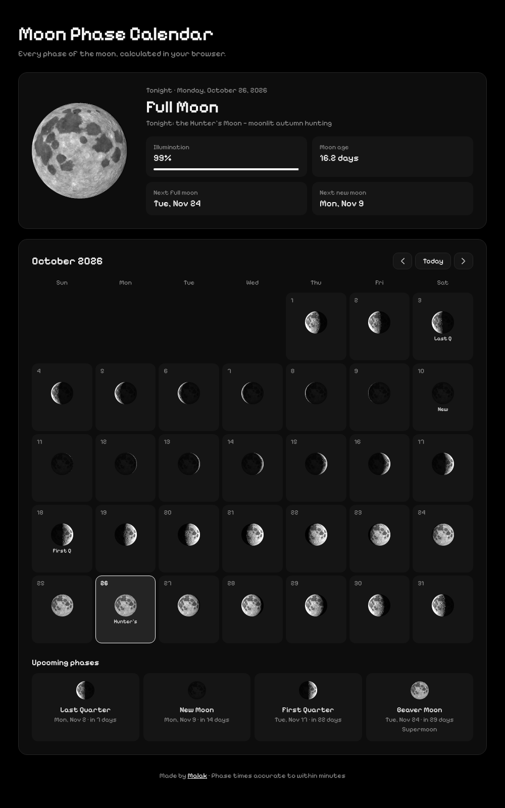

# 🌙 Moon Phase

A minimal black & white **desktop widget for macOS and Windows** that shows tonight's moon, plus a full **moon phase calendar** website.

Everything is calculated locally, with no internet, accounts or APIs needed.

<p align="center">
  
</p>

**🔗 Website:** https://mllaky.github.io/moon-phase-calendar/
**⬇️ Download the widget:** [Latest release](https://github.com/mllaky/moon-phase-calendar/releases/latest)

---

## ✨ Features

### Realistic moon
- The real moon's seas (maria) in their true positions, thousands of craters, and bright ray craters like **Tycho** and **Copernicus**
- **Real 3D lighting**: craters cast shading along the shadow line, the full moon looks flat and bright just like in the sky, and the dark side has a faint *earthshine* glow

<p align="center">
  
</p>

### Desktop widget (Mac & Windows)
- Tonight's **phase**, **illumination %**, and dates for the **next full and new moon**
- The **name of the moon**: Wolf, Harvest, Hunter's, Blue Moon, Supermoon and more
- A **7-night strip** showing how the moon will change this week
- **Drag it anywhere** on your desktop, and it remembers where you put it
- **Starts with your computer** (you can turn this off)
- **Always on your own time:** switches to the new day's moon at midnight, refreshes when your computer wakes up, and follows you across time zones
- **Pixel font** (Pixelify Sans) built in, so it works offline
- Lives in the menu bar / system tray, with no Dock or taskbar clutter
- Right-click the widget for options: keep on top, start at login, reset position, quit
- **Open calendar** button for the full monthly view

### Calendar website
- A drawn moon for every day of the month
- New, First Quarter, Full and Last Quarter marked on their days
- Click any day for its details
- Upcoming phases with countdowns
- Works on phones and desktops

<p align="center">
  
</p>

## ⬇️ Install the widget

1. Go to the [Releases page](https://github.com/mllaky/moon-phase-calendar/releases/latest).
2. Download the file for your computer:
   - **Mac:** `Moon-Phase-…-mac.dmg`. Open it and drag **Moon Phase** into Applications.
   - **Windows:** `Moon-Phase-Setup-…-windows.exe`. Run it.

> **First launch warnings:** the app isn't signed with a paid developer certificate, so your computer will warn you once.
> - **Mac:** if it says the app *can't be opened*, open **System Settings → Privacy & Security**, scroll down and click **Open Anyway**. Older macOS versions: right-click the app → **Open**.
> - **Windows:** on the blue SmartScreen box, click **More info → Run anyway**.

## 🧮 How it works

**Moon phases:** the app uses the formulas from Jean Meeus's *Astronomical Algorithms*, the standard reference used by astronomers, to calculate the exact time of every new moon, quarter and full moon. Results match the Old Farmer's Almanac to within a minute, for any year, past or future. Nothing is hard-coded, so it keeps working forever.

**Moon names:** every full moon gets its traditional name, worked out automatically each year:
- each month has its own name (Wolf, Snow, Worm, Pink, Flower, Strawberry, Buck, Sturgeon, Corn, Hunter's, Beaver, Cold)
- the **Harvest Moon** is the full moon closest to the September equinox, and the **Hunter's Moon** is the one after it
- a second full moon in the same month is a **Blue Moon**
- the app also calculates the Moon's distance from Earth, and labels full moons as a **Supermoon** (closer than ~362,500 km) or **Micromoon** (farther than 405,000 km)

Every day shows which named moon it belongs to, e.g. *"Growing toward the Beaver Moon"*, *"Tonight: the Hunter's Moon"*, or *"Fading after the Harvest Moon"*.

**Drawing the moon:** a Python script (`tools/generate_moon_texture.py`) builds the moon's surface: the seas placed at their real latitude/longitude, around 4,000 craters with rims and central peaks, and ray systems. In the browser, each pixel is lit by the sun from the angle that matches the phase (a Lommel–Seeliger lighting model), so the shadow line, crater shadows and earthshine all come out naturally.

## 🛠️ Built with

- **Electron**: turns the web page into a native Mac & Windows app
- HTML, CSS and vanilla JavaScript, with no frameworks
- Canvas API for drawing the moons pixel by pixel
- Pixelify Sans font (SIL Open Font License)
- Python (NumPy, SciPy, Pillow) to generate the moon surface
- **GitHub Actions**: automatically builds the `.dmg` and `.exe` installers

## 📁 Project structure

```
moon.js        → moon math + realistic lighting (shared by everything)
moon-texture.js→ the moon's surface, generated by tools/generate_moon_texture.py
index.html     → full calendar (also the website)
widget.html    → the small desktop widget
main.js        → desktop app: widget window, tray menu, settings
preload.js     → safely connects the widget's buttons to the app
tools/         → Python script that generates the moon surface
assets/        → icons and screenshots
.github/       → workflow that builds the installers
```

## 💻 Run it yourself

You'll need [Node.js](https://nodejs.org) installed.

```bash
git clone https://github.com/mllaky/moon-phase-calendar.git
cd moon-phase-calendar
npm install
npm start
```

Build an installer on your own machine: `npm run dist:mac` or `npm run dist:win`.

## 💡 Future ideas

- Moonrise and moonset times for your location
- Southern-hemisphere view (the moon appears mirrored)
- Hijri month start predictions
- Voice: *"What's the moon phase tonight?"*

## 👩‍💻 Author

**Malak**
[GitHub](https://github.com/mllaky)

## 📄 License

MIT. Free to use and learn from.
